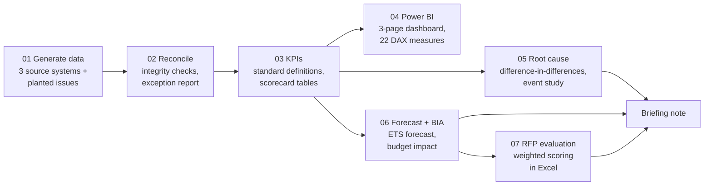
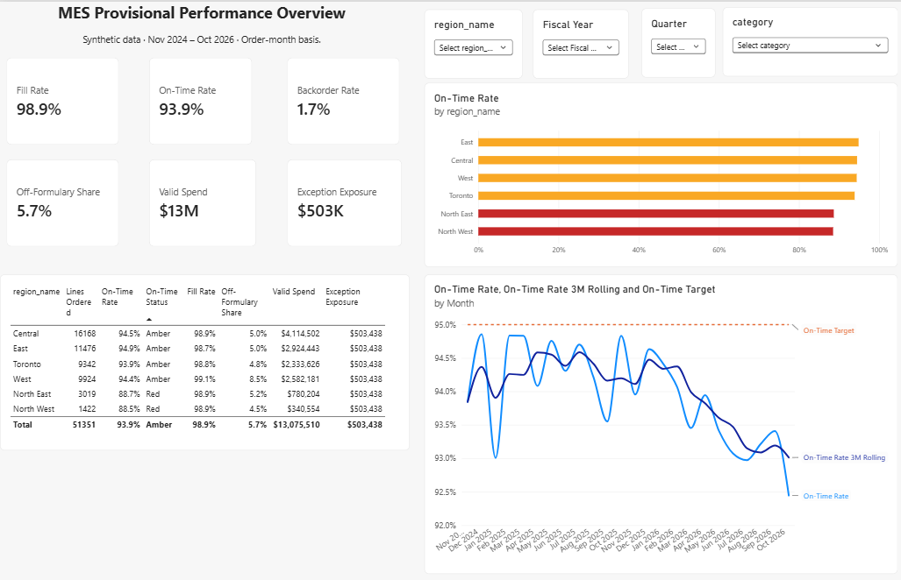
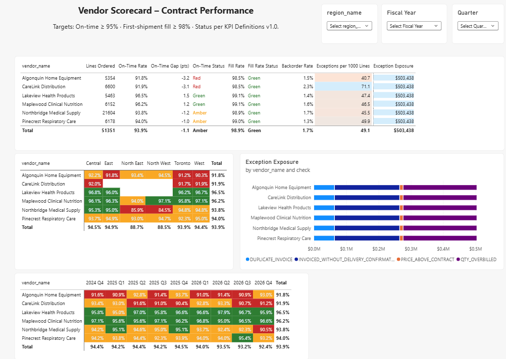
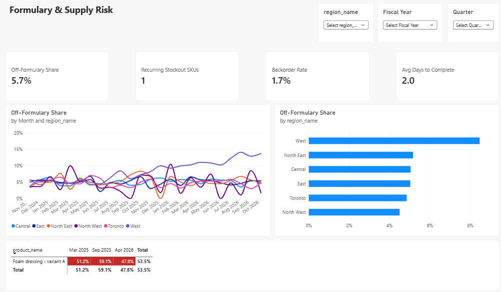

# Ontario MES Vendor Performance & Formulary Analytics

An end-to-end analytics project modelled on the work of a **Contract Specialist, Medical Equipment & Supplies (MES)** at Ontario Health atHome. It reconciles three source systems, sets standard KPI definitions, builds a Power BI vendor scorecard, finds the root cause of a vendor's delivery failure, models a formulary change, scores a mock RFP, and summarizes everything in a briefing note for decision-makers.

> **All data is synthetic.** Ontario Health atHome order-level data is not public, so `src/01_generate_data.py` generates a realistic dataset (51,351 order lines, 6 regions, 6 fictional vendors, 200 products, 24 months) with **known problems planted in it**. Every analysis step was then checked to confirm it finds those problems. The methods carry over to real data; the numbers do not.

---

## Headline findings

| Question | Finding | Step |
|---|---|---|
| Can the three source systems be trusted? | **2,567 exceptions (4.9% of order lines), $503K at risk**, mainly overbilled quantities ($229K) and invoices without proof of delivery ($202K). The script found all 2,567 planted defects, with no false positives. | 2 |
| Which vendor has a pricing problem? | V06 has **33.6** price-above-contract exceptions per 1,000 lines, against 5–8 for every other vendor. | 2 |
| Are vendors meeting their contract? | Province-wide on-time delivery is **93.6%** against a 95% target. V03 and V06 are below target every month; V01 fell suddenly in the North. | 3–4 |
| Is V01's Northern decline the vendor or the weather? | **The vendor: −17.5 points** (95% CI −21.0 to −14.0) after removing the winter effect, which is about −7 points for every Northern vendor. Fill rate didn't change, so the cause is transport, not stock. About 260 patients had a late delivery. | 5 |
| Should the top foam dressing be replaced? | Yes, with a long-wear product: **−$351K over 3 years**. The lowest-priced option would cost **+$23K**, because more frequent changes mean more nursing visits. The savings hold as long as the product needs fewer than 2.9 changes a week. | 6 |
| Who should supply it? | Mock RFP: **Boreal, 83.0/100**. The lowest unit-price bidder failed the technical threshold, and Boreal wins at every price weighting tested (30–50%). | 7 |

The decision document is the [briefing note](docs/briefing_note.pdf).

---

## Pipeline



---

## How this maps to the role

| Posting duty | Where it's shown |
|---|---|
| Standard provincial methods, definitions and data sources | [`docs/kpi_definitions.md`](docs/kpi_definitions.md): one written rule per KPI, coded once |
| Integrate, validate and reconcile data from multiple sources | `02_reconcile.py`: 9 integrity checks and 5 business checks, each exception with its dollar exposure |
| Dashboards, scorecards, Power BI | `powerbi/`: Overview, Vendor Scorecard and Formulary & Supply pages, with red/amber/green status from DAX |
| Vendor scorecards: service standards, recurring deficiencies, escalation | Vendor × region and vendor × quarter heatmaps; exception rates per 1,000 lines |
| Root-cause and trend analysis; financial, service, patient and regional impact | `05_root_cause.py`: difference-in-differences, event study, impact on patients |
| Formulary: utilization analysis and recommendations | `06_formulary_forecast_bia.py`: cost per healing episode, 3-year budget impact, sensitivity analysis |
| Forecasting, demand planning, scenario modelling | ETS demand forecast tested against simple benchmarks; phased-uptake scenarios |
| RFPs, business cases, procurement evaluation | `outputs/tables/rfp_evaluation.xlsx`: mandatory, technical and price stages, 115 live formulas |
| Briefing notes for governance | `docs/briefing_note.pdf` |
| Automate manual reporting | The whole pipeline reruns from raw data with one command per step |

---

## Repository structure

```
mes-analytics/
├── src/
│   ├── 01_generate_data.py          # synthetic data + planted issues (answer key: planted_issues.json)
│   ├── 02_reconcile.py              # three-way match, exception report
│   ├── 03_build_kpis.py             # KPI flags, vendor x region x month scorecard, stockout monitor
│   ├── 05_root_cause.py             # DiD regression, event study, diagnosis, impact
│   ├── 06_formulary_forecast_bia.py # ETS forecast, cost per episode, budget impact, tornado
│   └── 07_rfp_evaluation.py         # builds the RFP scoring workbook
├── powerbi/
│   ├── MES_Performance_Dashboard.pbix
│   ├── measures.dax                 # all 22 measures, commented
│   └── screenshots/
├── docs/
│   ├── kpi_definitions.md
│   └── briefing_note.pdf
├── outputs/
│   ├── figures/                     # charts from Steps 5-6
│   └── tables/                      # exception summary, event study, bia_model.xlsx, rfp_evaluation.xlsx
└── data/                            # raw/, clean/, model/ (regenerated by the scripts)
```

Step 4 is the Power BI dashboard, which is why there is no `04_*.py`.

---

## Dashboard

| Overview | Vendor Scorecard | Formulary & Supply |
|---|---|---|
|  |  |  |

The data model is a star schema: one order-line fact table, plus exceptions and stockout tables, linked to vendor, region, product and date tables. The Date table uses the Ontario fiscal year (April–March). **The DAX measures were checked against the Python pipeline and agree to the decimal.**

---

## Selected methods

**Reconciliation.** Orders are left-joined to deliveries and invoices, so no order line is lost. Duplicate invoices are removed before any comparison. Billed quantities are checked against confirmed deliveries, falling back to ordered quantities when a confirmation is missing. Every exception carries a dollar exposure.

**KPI rules.** Rates are always ratios of sums, never averages of percentages. Lines without a delivery confirmation are excluded, not counted as on time. Cells with fewer than 30 lines get no red/amber/green status. Results are reported by order month.

**Root cause.** A linear probability model with vendor × region and month × North fixed effects:

```
on_time = β · (V01 × North × post-Dec-2025) + vendor×region FE + month×North FE + ε
```

The month × North fixed effects absorb anything that hit every Northern delivery in a given month, including the weather. An event study shows flat trends before December 2025 (joint test p = 0.28), then a slide that levels off. Robust (HC1) standard errors.

**Forecast and budget impact.** Demand is units *ordered*, because deliveries are cut short by stockouts. A damped-trend ETS model had 8.7% error on held-out months, against 17.3% for a naive forecast. Options are compared on cost per healing episode, dressings plus nursing visits, the same total-cost approach used in health technology assessment budget impact analysis. The workbook includes one-way sensitivity analysis and a break-even wear time.

---

## Reproduce

Requires Python 3.10+.

```bash
pip install -r requirements.txt
python src/01_generate_data.py
python src/02_reconcile.py
python src/03_build_kpis.py
python src/05_root_cause.py
python src/06_formulary_forecast_bia.py
python src/07_rfp_evaluation.py
```

Seeded random generation (seed 42) means every run produces identical data and results. To refresh the dashboard, open `powerbi/MES_Performance_Dashboard.pbix` and point the data sources at your `data/` folder.

---

## Limitations

- **Synthetic data.** The vendor and bidder names are fictional, and the problems were planted deliberately.
- **Clinical and cost inputs to the budget model are illustrative**: wear times, nursing visit cost and the share of changes done by nurses. They are labelled on the *Parameters* sheet so they can be replaced with real values.
- **Small Northern samples** (about 110 V01 lines a month) make single months noisy. The late-period event-study estimate (about −30 points) is above the true planted effect (−23), but its confidence interval contains it.
- On-time delivery is judged on the first shipment, so it should always be read together with fill rate.

---

**Daniel Pazos Cordero**, financial economist, Ottawa · M.Sc. Applied Economics (Banking & Financial Markets), University of Bath
Related project: [doac-cua-ontario](https://github.com/98DanPazos/doac-cua-ontario), a Markov cost-utility and budget impact model
